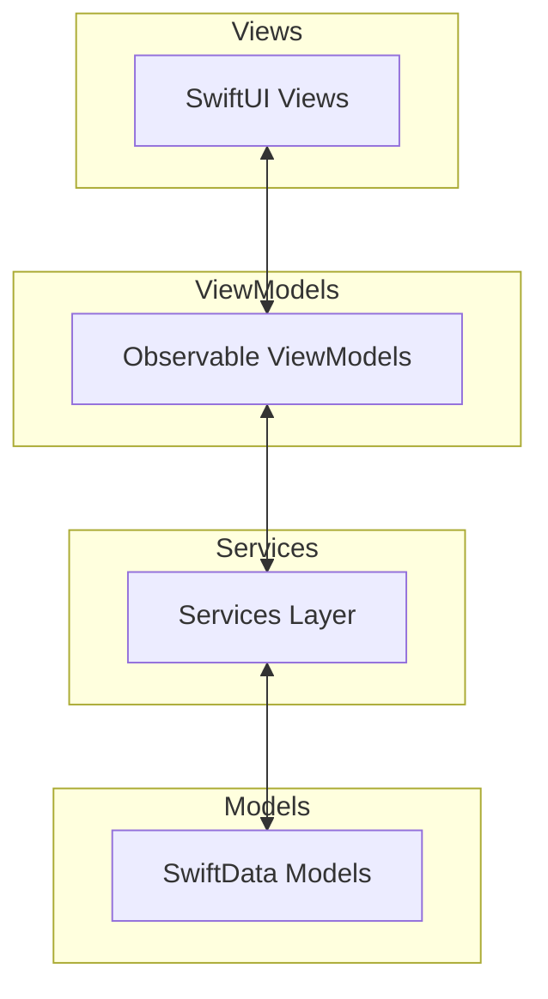
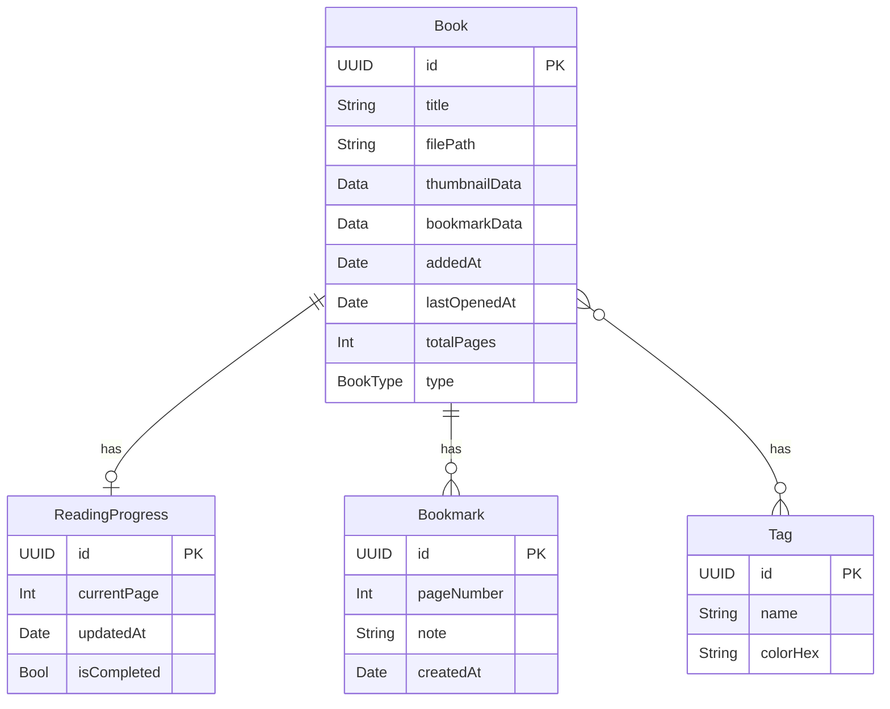

# MangaViewer

macOSとiPad向けのSwiftUI製漫画ビューワーアプリケーションです。macOS版はMac App Storeに対応しています。

## 概要

- 対応OS macOS 14（Sonoma）以降、iPadOS 17以降（iPadのみ）
- フレームワーク SwiftUI、SwiftData
- アーキテクチャ `@Observable`を使ったMVVM
- Swift 6.0（Strict Concurrency有効）
- App Sandbox macOS版で有効（セキュリティスコープブックマークでファイルアクセスを保持）
- バンドルID `work.okamyuji.mangaviewer`

## 機能

### 対応フォーマット

- CBZ / ZIP
- CBR / RAR
- 画像フォルダ（jpg, png, gif, webp）

画像を直接入れたフォルダを1冊として扱い、その中のフォルダは同じ本のページとして読みます。画像を直接入れていないフォルダ（シリーズのまとめなど）は、その中から本を探します。

128MBを超えるページは開きません。アーカイブは宣言された大きさで展開の前に止め、大きさを偽ったzipは展開の途中で止めます。フォルダの画像はファイルの大きさで判定します。画素数が5000万を超える画像は縮小して表示します。展開すると巨大になるファイル（zip爆弾）でメモリを使い切らないためです。

### リーダー機能

- 見開き表示（横長のページと縦向きのiPadは1ページ表示）
- 読み方向切替（左→右 / 右→左）
- ズームモード（ページフィット / 幅フィット / 高さフィット / 原寸 / 自由ズーム）
- キーボードナビゲーション（iPadは外付けキーボード）
- iPadのタッチ操作（タップ、スワイプ、縦向きで1ページ表示）
- 全画面モード
- しおり機能
- 画像フィルタ（明るさ / コントラスト / セピア / グレースケール）

### ライブラリ機能

- フォルダ監視による自動検知（macOSはDispatchSource、iPadは起動時、フォルダの追加時、引き下げ操作で読み直し）。「本を追加」で選んだフォルダも監視フォルダに登録します
- サイドバーのサムネイル付き一覧
- 既読管理
- タグ付け
- 検索・ソート
- Finderからのダブルクリック / ドラッグ＆ドロップ対応

## アーキテクチャ



## ディレクトリ構成

```shell
MangaViewer/
├── Package.swift                    # SPMパッケージ定義
├── project.yml                      # XcodeGen設定
├── Info.plist                       # macOS版のアプリ情報
├── Info-iPad.plist                  # iPad版のアプリ情報
├── MangaViewer.entitlements         # App Sandboxエンタイトルメント
├── Local.xcconfig.template          # ビルド設定テンプレート
│
├── Sources/MangaViewer/
│   ├── MangaViewerApp.swift
│   │
│   ├── Models/
│   │   ├── Book.swift
│   │   ├── BookType.swift
│   │   ├── ReadingProgress.swift
│   │   ├── Bookmark.swift
│   │   └── Tag.swift
│   │
│   ├── Services/
│   │   ├── ArchiveService.swift
│   │   ├── ZipExtractor.swift
│   │   ├── RarExtractor.swift
│   │   ├── FolderLoader.swift
│   │   ├── ImageCache.swift
│   │   ├── ImageFileFilter.swift
│   │   ├── LibraryWatcher.swift
│   │   ├── MangaViewerError.swift
│   │   ├── PageProvider.swift
│   │   ├── SecurityScopedBookmarkManager.swift
│   │   └── ThumbnailGenerator.swift
│   │
│   ├── ViewModels/
│   │   ├── LibraryViewModel.swift
│   │   ├── ReaderViewModel.swift
│   │   └── SettingsViewModel.swift
│   │
│   ├── Views/
│   │   ├── ContentView.swift
│   │   ├── Library/
│   │   │   ├── SidebarView.swift
│   │   │   └── AddTagSheet.swift
│   │   ├── Reader/
│   │   │   ├── ReaderView.swift
│   │   │   ├── SpreadView.swift
│   │   │   ├── ZoomableImageView.swift
│   │   │   ├── ReaderToolbar.swift
│   │   │   ├── KeyboardHandlerView.swift  # macOSのキー入力
│   │   │   └── TouchReaderControls.swift  # iPadのタップとスワイプ
│   │   └── Settings/
│   │       └── SettingsView.swift
│   │
│   └── Utilities/
│       ├── Constants.swift
│       ├── ImageFilter.swift
│       ├── PlatformImage.swift      # NSImageとUIImageの共通化
│       ├── ReaderCommand.swift      # キー入力とリーダー操作の対応
│       ├── ReaderGesture.swift      # タップとスワイプの判定
│       ├── SampleBook.swift         # テスト用サンプル本の生成（DEBUGのみ）
│       ├── ReadingDirection.swift
│       ├── SortOrder.swift
│       └── ZoomMode.swift
│
├── Tests/MangaViewerTests/          # macOSとiPadで共有する単体テスト
├── UITests/MangaViewerUITests/      # iPadシミュレータのUIテスト
├── UITests/MangaViewerUITests-macOS/ # macOSのUIテスト
├── docs/adr/                        # 設計判断の記録
│
├── Resources/
│   ├── Assets.xcassets/             # アプリアイコン
│   └── PrivacyInfo.xcprivacy        # プライバシーマニフェスト
│
├── scripts/
│   ├── build-app.sh                 # SPMリリースビルド＋.app作成
│   ├── generate-icon.swift          # アプリアイコンの生成
│   ├── stamp-version.sh             # ビルドしたアプリに版とビルド番号を書く
│   └── stamp-version.test.sh        # stamp-version.shの試験
│
└── fastlane/
    ├── Appfile
    └── Fastfile
```

## データモデル



## セットアップ

### ビルド設定

XcodeGen + Local.xcconfigでチームIDなどの環境依存設定を管理しています。

```bash
# テンプレートからLocal.xcconfigを作成
cp Local.xcconfig.template Local.xcconfig

# DEVELOPMENT_TEAMを自分のチームIDに変更
# Local.xcconfigはgitignoreされています
```

### iPadへのインストール

1. `Local.xcconfig`の`DEVELOPMENT_TEAM`に、Apple Developer Programに登録したチームIDを書きます。
2. 自分のチームでビルドするときは、`project.yml`の`PRODUCT_BUNDLE_IDENTIFIER`をすべて自分のIDに変えます。同じApp IDは別のチームで登録できないためです。アプリ本体（`MangaViewer`と`MangaViewer-iPad`）と試験（`MangaViewerTests`、`MangaViewerTests-iPad`、`MangaViewerUITests-iPad`）で、同じ接頭辞を使います。
3. `xcodegen generate`でプロジェクトを生成し、Xcodeで`MangaViewer-iPad`スキームを選びます。
4. iPadをMacに接続して実行先に選び、実行します。

Xcodeを開かずにコマンドで入れる場合は、次のとおりです。iPadの「設定」>「プライバシーとセキュリティ」で「デベロッパモード」を有効にしておきます。

```bash
# 接続したiPadの識別子を調べる
xcrun devicectl list devices

# そのiPad向けのReleaseビルド。iPadを開発者アカウントに登録し、署名用のプロファイルを作成・更新します
xcodebuild -project MangaViewer.xcodeproj -scheme MangaViewer-iPad -configuration Release \
  -destination "platform=iOS,id=<識別子>" -derivedDataPath build/ipad \
  -allowProvisioningUpdates -allowProvisioningDeviceRegistration build

# インストール
xcrun devicectl device install app --device <識別子> build/ipad/Build/Products/Release-iphoneos/MangaViewer.app
```

本は「ファイル」アプリの場所をそのまま参照します。ライブラリと読書の進み具合は端末ごとに保存され、macOS版とは同期しません。

### Xcodeプロジェクト生成

```bash
# XcodeGenでプロジェクトを生成
xcodegen generate

# Xcodeで開く
open MangaViewer.xcodeproj
```

## 開発コマンド

### ビルド

```bash
# デバッグビルド
swift build

# リリースビルド
swift build -c release

# macOS アプリバンドル (.app) を作成
./scripts/build-app.sh
```

### 実行

```bash
# デバッグ実行
swift run

# リリースビルドを実行
swift run -c release

# アプリバンドルを起動
open .build/release/MangaViewer.app

# Applicationsにインストール
cp -R .build/release/MangaViewer.app /Applications/
```

### テスト

```bash
# 全テスト実行
swift test

# 特定のテストスイートを実行
swift test --filter ImageFileFilterTests

# 詳細出力
swift test --verbose
```

### 版番号

mainへのpushでCIの全ジョブが通ると、その先頭のコミットに`vX.Y.Z`タグが付きます。これを1回のリリースとします。PRはsquashマージするので、上げる桁はPRの題名の種類で決まります。

- `feat!:`や本文の`BREAKING CHANGE:`はmajorを上げます。
- `feat:`はminorを上げます。
- それ以外（`fix:`、`test:`、`chore:`など）はpatchを上げます。

アプリの版（`CFBundleShortVersionString`）は、ビルドしたコミットから辿れる最新の`vX.Y.Z`タグです。ビルド番号（`CFBundleVersion`）はコミット数です。Xcode、fastlane、`scripts/build-app.sh`のどれでビルドしても、`scripts/stamp-version.sh`が同じ値を書きます。タグが無いビルドは`0.0.0`になります。

### Linter / Formatter

```bash
# SwiftLint: Lintチェック
swiftlint lint --quiet

# SwiftLint: 自動修正
swiftlint lint --fix

# SwiftFormat: フォーマット
swiftformat .

# SwiftFormat: ドライラン（変更を表示するのみ）
swiftformat . --dryrun
```

### Fastlane

```bash
# 依存関係インストール
bundle install

# macOSの単体テストとUIテスト
# UIテストの初回は、自動化モードを認証なしで有効にしておきます
sudo automationmodetool enable-automationmode-without-authentication
bundle exec fastlane test

# iPadシミュレータでの単体テストとUIテスト
bundle exec fastlane ipad_test

# macOSとiPadのリリースビルド
bundle exec fastlane build
```

### クリーン

```bash
# ビルドキャッシュをクリア
swift package clean

# 完全クリーン（.buildディレクトリ削除）
rm -rf .build
```

### 依存関係

```bash
# 依存関係を更新
swift package update

# 依存関係を解決
swift package resolve

# 依存関係を表示
swift package show-dependencies
```

## App Sandbox

Mac App Store配布のためApp Sandboxに対応しています。

### エンタイトルメント

| キー | 用途 |
| ---- | ---- |
| `com.apple.security.app-sandbox` | App Sandbox有効化 |
| `com.apple.security.files.user-selected.read-write` | ファイル選択ダイアログで選んだファイルへのアクセス |
| `com.apple.security.files.bookmarks.app-scope` | セキュリティスコープブックマークで再起動後もアクセス維持 |

### セキュリティスコープブックマーク

`SecurityScopedBookmarkManager`（actor）がブックマークの保存・復元・アクセス管理を担当。ユーザーが選択したファイル/フォルダへのアクセスをアプリ再起動後も維持します。iPadOSには`.withSecurityScope`がないため、`BookmarkOptions`がプラットフォームごとの指定を切り替えます。

## キーボードショートカット

macOSとiPadの外付けキーボードで同じキーを使います。macOSはキーの位置をUS配列で判定し、iPadは入力された文字で判定します。

| キー | 動作 |
| ---- | ---- |
| `←` / `→` | 前/次ページ（読み方向対応） |
| `Space` | 次ページ |
| `F` | 全画面切替 |
| `=` / `-` | ズームイン/アウト |
| `0` | フィットモードに戻す |
| `B` | しおりの追加/削除 |
| `Esc` | リーダーを閉じる |

## iPadのタッチ操作

| 操作 | 右綴じ | 左綴じ |
| ---- | ------ | ------ |
| 画面の左3分の1をタップ | 次ページ | 前ページ |
| 画面の右3分の1をタップ | 前ページ | 次ページ |
| 右方向へスワイプ | 次ページ | 前ページ |
| 左方向へスワイプ | 前ページ | 次ページ |
| 中央をタップ | ツールバーの表示切替 | ツールバーの表示切替 |

iPadを縦にすると1ページずつ、横にすると見開きで表示します。Stage Managerの窓のように縦横の差が1割以内のときは、今の表示を保ちます。ページが画面からはみ出している向き（ズーム中や幅フィットの縦方向）のドラッグは、画像の移動に使います。

## 設定項目

### 読書設定

- デフォルト読み方向（左→右 / 右→左）
- デフォルトズームモード

### ライブラリ設定

- 監視フォルダ一覧

macOSでは設定ウィンドウ、iPadではサイドバーの歯車ボタンから開きます。

## 画像キャッシュ戦略

- **実装**: NSCache + ImageCacheActor（Swift Concurrency対応）
- **最大容量**: 50枚 or 500MB
- **先読み**: 現在ページの前後3ページ
- **優先度**: 現在ページ > 次ページ > 前ページ > ...
- **世代管理**: ブック切替時にキャッシュを無効化

## 画像フィルタ

| フィルタ | Core Imageフィルタ | 範囲 |
| -------- | ----------------- | ---- |
| Brightness | CIColorControls | -1.0 ~ 1.0 |
| Contrast | CIColorControls | 0.5 ~ 2.0 |
| Sepia | CISepiaTone | 0.0 ~ 1.0 |
| Grayscale | CIPhotoEffectMono | - |

## 依存ライブラリ

| ライブラリ | 用途 | リポジトリ |
| --------- | ---- | --------- |
| ZIPFoundation | ZIP/CBZ展開 | <https://github.com/weichsel/ZIPFoundation> |
| Unrar.swift | RAR/CBR展開 | <https://github.com/mtgto/Unrar.swift> |

## ライセンス

MIT License
